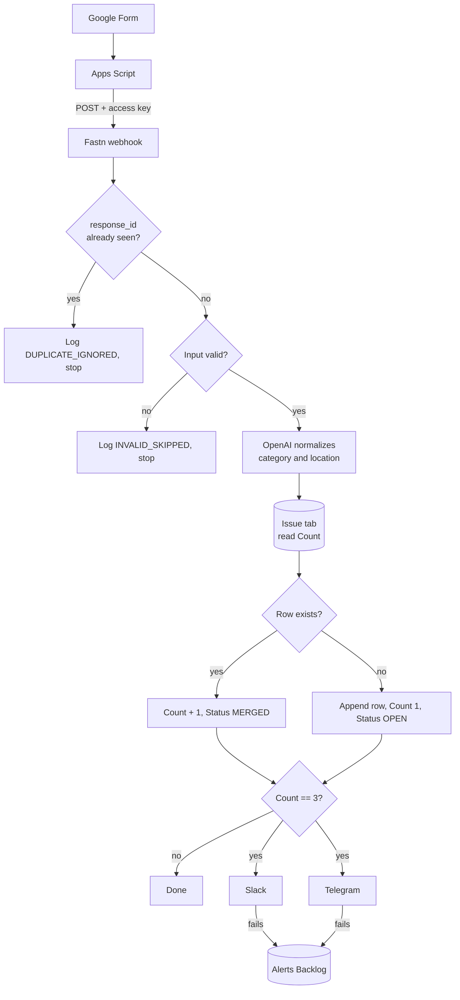

# Campus Echo

Anonymous campus issue reporting with duplicate merging and threshold alerts.

Students report problems (broken AC, Wi-Fi down, water leaks) through a Google Form. The same problem usually arrives several times in different wording. Campus Echo normalizes each report, merges matching ones into a single tracked issue, and alerts the facilities team only when an issue has been reported three times.

Built on [Fastn](https://fastn.ai) for the Build with Fastn hackathon at SEECS, NUST.

## How it works



1. **Delivery check.** The `response_id` is looked up in `fastn.state` and the `Logs` tab. A repeat delivery is logged and dropped.
2. **Validation.** `category`, `location` (3+ characters) and `description` (5+ characters) are required. Invalid reports are logged and stop here.
3. **Normalization.** OpenAI (`gpt-4o-mini`) turns category and location text into short keys, for example `hvac_issue` and `seecs-a-204`, so differently worded reports match. Roman Urdu and English reports map to the same keys. If the OpenAI call fails, a deterministic fallback builds the keys.
4. **State.** The `Issue` tab is the only source of truth. If a row with the same keys exists, its `Count` is read from the sheet and incremented. If not, the sheet is read again and a new row is appended.
5. **Escalation.** When the new `Count` is exactly 3, Slack and Telegram are called in parallel. Counts 1, 2, 4 and above send nothing.
6. **Failures.** Each channel has its own error handling. A failed channel writes a row to `Alerts Backlog` and does not affect the other. Secrets are redacted from logged errors.

## Stack

| Part | Used for |
|---|---|
| Google Forms + Apps Script | Intake and webhook call |
| Fastn (webhook trigger, workflow, `fastn.state`, `fastn.envConfig`) | Orchestration |
| OpenAI `gpt-4o-mini` | Text normalization |
| Google Sheets | Issue state, audit log, failed alerts |
| Slack | Primary alert, `#campus-echo-alerts` |
| Telegram Bot API | Second alert, HTTP POST to `sendMessage` |

## Google Sheet

One spreadsheet, three tabs. Headers must match exactly. The workflow addresses the spreadsheet by its ID (the string between `/d/` and `/edit` in the URL), not its name.

**`Issue`** (`A:G`)

| Category Key | Location Key | Count | Status | First Reported | Last Reported | Latest Description |
|---|---|---|---|---|---|---|

**`Logs`** (`A:E`)

| Timestamp | Response ID | Event | Details | Outcome |
|---|---|---|---|---|

**`Alerts Backlog`** (`A:F`)

| Timestamp | Category | Location | Count | Urgency | Error Reason |
|---|---|---|---|---|---|

Events written to `Logs`: `RECEIVED`, `DUPLICATE_IGNORED`, `INVALID_SKIPPED`, `NEW_ISSUE`, `MERGED_DUPLICATE`, `ESCALATION_SLACK_SENT`, `ESCALATION_TELEGRAM_SENT`, `ESCALATION_FALLBACK_LOGGED`, `ESCALATION_FANOUT_SUMMARY`.

## Setup

### 1. Google Form

Create a form with these questions. Titles must match exactly, because the script reads answers by title.

| Title | Type | Required |
|---|---|---|
| `Category` | Dropdown: HVAC/AC, Wi-Fi/Network, Plumbing/Water, Electrical, Cleanliness, Other | Yes |
| `Location` | Short answer | Yes |
| `Description` | Paragraph | Yes |
| `Urgency` | Dropdown: Low, Medium, High | Yes |

Do not collect email addresses and do not limit responses to one per person.

### 2. Slack and Telegram

- Slack: create the channel `#campus-echo-alerts`. If posting fails with "not in channel", invite the Fastn app to it.
- Telegram: create a bot with @BotFather and copy the token. Open the bot and press Start. Open `https://api.telegram.org/bot<TOKEN>/getUpdates` in a private window and read `chat.id`.

### 3. Fastn

1. Create the workflow `campus_echo_issue_processor` with the Fastn Agent (Integrations → Agent).
2. Connect Google Sheets, Slack and OpenAI.
3. Add these environment configuration values, in every environment you use:

   | Name | Value |
   |---|---|
   | `TELEGRAM_BOT_TOKEN` | Token from BotFather |
   | `TELEGRAM_CHAT_ID` | Chat ID from `getUpdates` |

4. Publish a snapshot and deploy it to the `Live` environment.
5. Add a Webhook trigger (Integrations → Triggers → Add trigger). Use Copy as cURL to get the webhook URL and access key.
6. Turn on failure alerts under Activity → Alerts.

### 4. Apps Script

In the Form, open Extensions → Apps Script and paste:

```javascript
function onFormSubmitToFastn(e) {
  var data = { response_id: e.response.getId() };
  e.response.getItemResponses().forEach(function (item) {
    var title = item.getItem().getTitle();
    if (title === "Category") data.category = item.getResponse();
    if (title === "Location") data.location = item.getResponse();
    if (title === "Description") data.description = item.getResponse();
    if (title === "Urgency") data.urgency = item.getResponse();
  });

  var options = {
    method: "post",
    contentType: "application/json",
    headers: { "x-fastn-access-key": "PASTE_WEBHOOK_KEY_HERE" },
    payload: JSON.stringify(data)
  };

  UrlFetchApp.fetch("PASTE_WEBHOOK_URL_HERE", options);
}
```

Replace the two placeholders, then add a trigger: function `onFormSubmitToFastn`, event source From form, event type On form submit. Do not run the function manually; it only works when a real submission triggers it.

## Test

Send three reports for the same room, worded differently:

| # | Location | Description |
|---|---|---|
| 1 | `SEECS Block A, Room 204` | `The AC is broken and the room is very hot` |
| 2 | `seecs block a rm 204` | `air conditioner not working since morning` |
| 3 | `SEECS block A room #204` | `AC not cooling at all, students cannot concentrate` |

Expected:

- After 1: one `Issue` row, `Count` 1, `Status` OPEN.
- After 2: same row, `Count` 2, `Status` MERGED.
- After 3: `Count` 3, one Slack message, one Telegram message, and `ESCALATION_SLACK_SENT`, `ESCALATION_TELEGRAM_SENT` and `ESCALATION_FANOUT_SUMMARY` rows in `Logs`.
- A fourth report updates the row and sends nothing.

To test from the Fastn Test tab, use a fresh `response_id` each run. A reused ID is treated as a duplicate.

```json
{"response_id":"test-001","category":"HVAC/AC","location":"SEECS Block A, Room 204","description":"The AC is broken and the room is very hot","urgency":"Medium"}
```

## Edge cases

| Case | Result |
|---|---|
| Same `response_id` delivered twice | Logged as `DUPLICATE_IGNORED`, nothing else changes |
| Blank or too-short fields | Logged as `INVALID_SKIPPED`, not sent to OpenAI or written to `Issue` |
| OpenAI call fails | Fallback keys are used and processing continues |
| Count above 3 | No repeat alert |
| Slack fails | Telegram still sends, failure goes to `Alerts Backlog` |
| Telegram fails | Slack still sends, failure goes to `Alerts Backlog` prefixed `TELEGRAM:` |

## Limitations

- Google Sheets has no locking. Two reports of a brand-new issue arriving at the same instant can create two rows. A re-read before insert narrows the window but does not close it.
- A delivery is marked received before processing. If a run crashes partway, a retry is dropped, not repeated.
- Reports are anonymous, so one person can submit all three reports for an issue.
- If OpenAI is down, fallback keys may not match keys created by the AI step, so a report may not merge with earlier ones.
- The Telegram recipient must press Start on the bot first.
- This is not an emergency system. Emergencies go to campus security.
